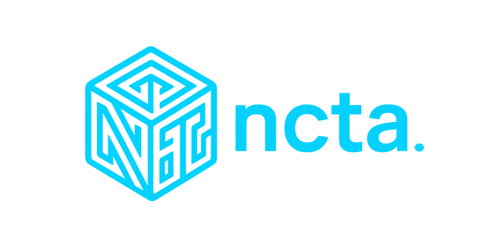

  
The Final Chapter

  

    
    <h2 class="contact-title">Let's Connect</h2>
    
✦

    

      
Cao Thien An Nguyen

      
<a class="wisc-link" href="https://www.wisc.edu/" target="_blank" rel="noopener">University of Wisconsin–Madison</a>

      

        
Open to internships

        
I would really love to connect with you.

      

      <a href="mailto:cnguyen49@wisc.edu" class="contact-email"><i class="fas fa-envelope"></i> cnguyen49@wisc.edu</a>
    

    

      <a href="https://github.com/aansensei" target="_blank" class="contact-icon-btn" title="GitHub"><i class="fab fa-github"></i></a>
      <a href="https://www.linkedin.com/in/cao-thien-an-nguyen" target="_blank" class="contact-icon-btn" title="LinkedIn"><i class="fab fa-linkedin-in"></i></a>
      <a href="mailto:cnguyen49@wisc.edu" class="contact-icon-btn" title="Email"><i class="fas fa-paper-plane"></i></a>
    

    
If you've reached this page, perhaps the data has a story for you too. Let's write the next chapter together.

  

  

    <form class="contact-form" id="contactForm" action="https://formsubmit.co/cnguyen49@wisc.edu" method="POST">
      <h3 class="cf-title">Send Me a Message</h3>
      
✦

      
<label for="cf-name">Name</label><input id="cf-name" name="name" type="text" required maxlength="80" autocomplete="name" placeholder="Your name">

      
<label for="cf-email">Email</label><input id="cf-email" name="email" type="email" required maxlength="120" autocomplete="email" placeholder="you@example.com">

      
<label for="cf-subject">Subject</label><input id="cf-subject" name="subject" type="text" required maxlength="120" placeholder="What is this about?">

      
<label for="cf-message">Message</label><textarea id="cf-message" name="message" required maxlength="3000" rows="5" placeholder="Write your message here"></textarea>

      <input type="text" name="_honey" class="cf-honey" tabindex="-1" autocomplete="off" aria-hidden="true">
      <input type="hidden" name="_captcha" value="false">
      <input type="hidden" name="_template" value="table">
      <button type="submit" class="cf-send" id="cfSend"><i class="fas fa-paper-plane cf-plane" id="cfIcon"></i>Send message</button>
      

      <!-- An orbit seal for each stage of this message's journey. -->
      

        <i class="cf-state-sparkle sp1" aria-hidden="true">&#10022;</i>
        <i class="cf-state-sparkle sp2" aria-hidden="true">&#10023;</i>
        

          

            
          

          

            A Scroll Takes Flight
            <h4 class="cf-state-title" id="cfStateTitle">Sending your scroll...</h4>
          

        

        
Your words are setting out across the stars.

        

          <button type="button" class="cf-state-btn cf-state-btn-primary" id="cfRetryBtn">Send the Scroll Again</button>
          <a class="cf-state-btn cf-state-btn-secondary" href="mailto:cnguyen49@wisc.edu" id="cfMailtoBtn">Open in my email app</a>
          <button type="button" class="cf-state-btn cf-state-btn-secondary" id="cfCopyBtn">Copy message</button>
          <a class="cf-state-btn cf-state-btn-ghost" href="/" id="cfHomeBtn">Return to Cockpit</a>
        

      

    </form>
  

  

    

    

    

    

    
<h3 id="ab-title"></h3>

  

